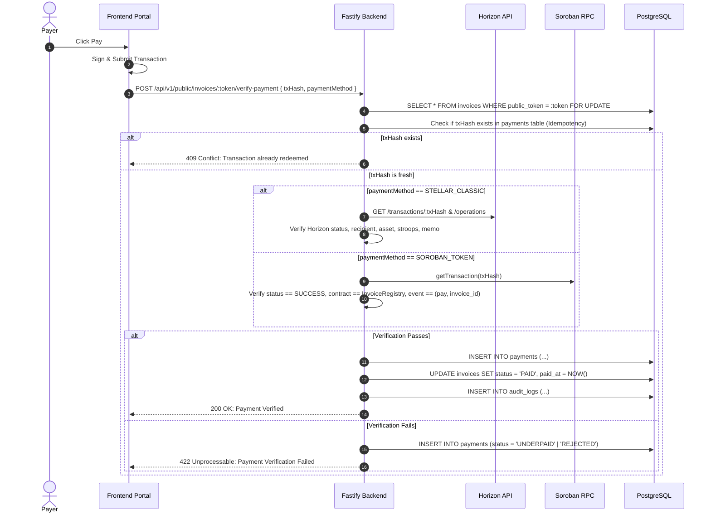

# Backend REST API — Integration Specification & Architecture Contract

**Repository:** `bill-generator-backend`  
**OpenAPI Source of Truth:** [`bill-generator-backend/openapi.yaml`](../openapi.yaml)  
**Framework:** Fastify + TypeScript (Node.js v24+)  
**Cross-References:**  
- Smart Contract Specification: [`bill-generator-contracts/docs/CONTRACT_SPEC.md`](../../bill-generator-contracts/docs/CONTRACT_SPEC.md)
- Frontend Integration Specification: [`bill-generator-frontend/docs/INTEGRATION_SPEC.md`](../../bill-generator-frontend/docs/INTEGRATION_SPEC.md)
- Root Architecture Plan: [`PROJECT_PLAN.md`](../../PROJECT_PLAN.md)

---

## 1. API Base URL & Versioning Policy

### 1.1 Base URL Configuration
- **Local Development:** `http://localhost:4000/api/v1`
- **Testnet Staging:** `https://api-testnet.stellarbills.com/api/v1`
- **Health Probes:**
  - `GET /health` — Fastify liveness probe (returns HTTP 200 `{ "status": "ok" }`).
  - `GET /health/ready` — Readiness probe checking PostgreSQL connection pool, Horizon connectivity, and Soroban RPC health.

### 1.2 Versioning Strategy
- Explicit URI path versioning: `/api/v1/...`.
- Breaking changes (field removals, type alterations, auth modifications) require bumping the URI version to `/api/v2/`.
- Non-breaking changes (new optional fields, additional query filters) are rolled out within `v1`.

---

## 2. Authentication & Authorization Model

### 2.1 Public vs. Authenticated Operations

| Category | Endpoint Scope | Authorization Scheme | Access Guard |
| :--- | :--- | :--- | :--- |
| **System** | `/health`, `/health/ready` | None (Public) | None |
| **Authentication** | `/api/v1/auth/*` | None (Public) | Rate-limited per IP (10 req/min) |
| **Merchant Admin** | `/api/v1/merchant/*`, `/api/v1/clients/*`, `/api/v1/invoices/*` | Authenticated | `Authorization: Bearer <JWT>` header required. Enforces tenant isolation: `WHERE merchantId = req.user.id`. |
| **Public Pay Portal** | `/api/v1/public/invoices/:publicToken/*` | Capability Token | Unguessable 256-bit URL capability token. Returns 404 for `DRAFT` invoices. Rate-limited (30 req/min). |

### 2.2 Dual Authentication Protocols

1. **Standard JWT Bearer:**
   - Client sends credentials to `POST /api/v1/auth/login`.
   - Backend verifies password using Argon2id and returns signed JWT with 7-day expiry:
     ```json
     {
       "sub": "b6e12e3e-4b2a-4a5f-8c3b-123456789abc",
       "email": "merchant@company.com",
       "stellarAddress": "GB7B...XYZ",
       "iat": 1729375200,
       "exp": 1729980000
     }
     ```
   - Client sends `Authorization: Bearer <token>` on all admin requests.

2. **Web3 Stellar SEP-10 Authentication:**
   - Step 1: Frontend requests challenge via `POST /api/v1/auth/stellar-challenge` `{ stellarAddress }`.
   - Step 2: Backend builds a valid SEP-10 transaction containing a time-bounded manage data operation signed by server key.
   - Step 3: Merchant signs the transaction with their non-custodial wallet (Freighter).
   - Step 4: Frontend submits signed transaction to `POST /api/v1/auth/stellar-verify` `{ signedTransaction }`.
   - Step 5: Backend verifies cryptographic signature against `stellarAddress` and returns a standard JWT session token.

---

## 3. Standard Response Envelopes & Error Representation

### 3.1 Success Response Envelope
All non-binary successful responses are wrapped in a standard JSON envelope:

```typescript
// Single Item
interface SingleEnvelope<T> {
  data: T;
}

// Paginated Collection
interface PaginatedEnvelope<T> {
  data: T[];
  meta: {
    page: number;
    limit: number;
    totalCount: number;
    totalPages: number;
    hasNextPage: boolean;
    hasPrevPage: boolean;
  };
}
```

### 3.2 Error Representation (RFC 7807 Problem Details)
All HTTP 4xx and 5xx responses use the `application/problem+json` media type:

```json
{
  "type": "https://errors.stellarbills.com/payment-underpaid",
  "title": "Payment Verification Failed",
  "status": 422,
  "detail": "Received 15000000 stroops but invoice requires 25000000 stroops.",
  "instance": "/api/v1/public/invoices/pub_9f8a1b2c/verify-payment",
  "code": "PAYMENT_UNDERPAID",
  "timestamp": "2026-10-19T21:55:00Z",
  "invalidParams": [
    {
      "name": "amountStroops",
      "reason": "Insufficient balance transferred"
    }
  ]
}
```

### 3.3 Canonical Error Codes
- `VALIDATION_ERROR` (400)
- `UNAUTHORIZED` (401)
- `FORBIDDEN` (403)
- `NOT_FOUND` (404)
- `RESOURCE_CONFLICT` (409) — e.g. duplicate invoice number or duplicate payment hash.
- `INVOICE_NOT_EDITABLE` (409) — attempting to mutate an issued/paid invoice.
- `PAYMENT_UNDERPAID` (422)
- `PAYMENT_WRONG_RECIPIENT` (422)
- `PAYMENT_WRONG_ASSET` (422)
- `PAYMENT_WRONG_MEMO` (422)
- `UPSTREAM_RPC_ERROR` (502)

---

## 4. Monetary Calculations & Zero-Floating-Point Invariants

### 4.1 Strict Representation Rules
1. **Never use JavaScript `number` or `parseFloat` for money.**
2. Line-item prices, subtotals, taxes, and totals are serialized and transported as string-encoded integers.
3. Quantities are scaled by $10^4$ (4 decimal places):
   - Example: $1.5\text{ hours}$ is represented as `quantityScale4 = "15000"`.
4. Unit prices are represented in minor units:
   - Example: $\$50.00\text{ USD}$ is represented as `unitPriceMinor = "5000"`.
   - Line subtotal calculation:
     $$\text{totalMinor} = \frac{\text{BigInt}(\text{quantityScale4}) \times \text{BigInt}(\text{unitPriceMinor}) + 5000n}{10000n}$$
5. Taxes and discounts are expressed in basis points ($1\% = 100\text{ bps}$):
   $$\text{taxMinor} = \frac{\text{subtotalMinor} \times \text{BigInt}(\text{taxRateBps}) + 5000n}{10000n}$$

### 4.2 Horizon String-to-BigInt Decimal Parser
Horizon returns transaction amounts as decimal strings with 7 decimal places (e.g. `"100.5000000"`). The backend parses this strictly without floating point:

```typescript
export function parseDecimalStringToStroops(decimalStr: string): bigint {
  const [whole, fraction = ''] = decimalStr.split('.');
  const paddedFraction = fraction.padEnd(7, '0').slice(0, 7);
  return BigInt(whole) * 10_000_000n + BigInt(paddedFraction);
}
```

---

## 5. Canonical Invoice ID & On-Chain Content Hash

### 5.1 On-Chain Identifier Derivation
The canonical 32-byte identifier sent to the Soroban contract is:

```typescript
import { createHash } from 'node:crypto';

export function deriveOnchainInvoiceId(merchantId: string, invoiceNumber: string): string {
  const rawInput = `stellar-invoice:${merchantId}:${invoiceNumber}`;
  return '0x' + createHash('sha256').update(rawInput, 'utf8').digest('hex');
}
```

### 5.2 Deterministic RFC 8785 Canonical Hash
Before issuing an invoice, the backend constructs the canonical payload, canonicalizes its keys using RFC 8785, and computes the SHA-256 hash:

```typescript
import canonicalize from 'canonicalize';
import { createHash } from 'node:crypto';

export function computeInvoiceContentHash(canonicalPayload: object): string {
  const canonicalJson = canonicalize(canonicalPayload);
  if (!canonicalJson) throw new Error('Serialization failed');
  return '0x' + createHash('sha256').update(canonicalJson, 'utf8').digest('hex');
}
```

---

## 6. Payment Verification Pipeline


