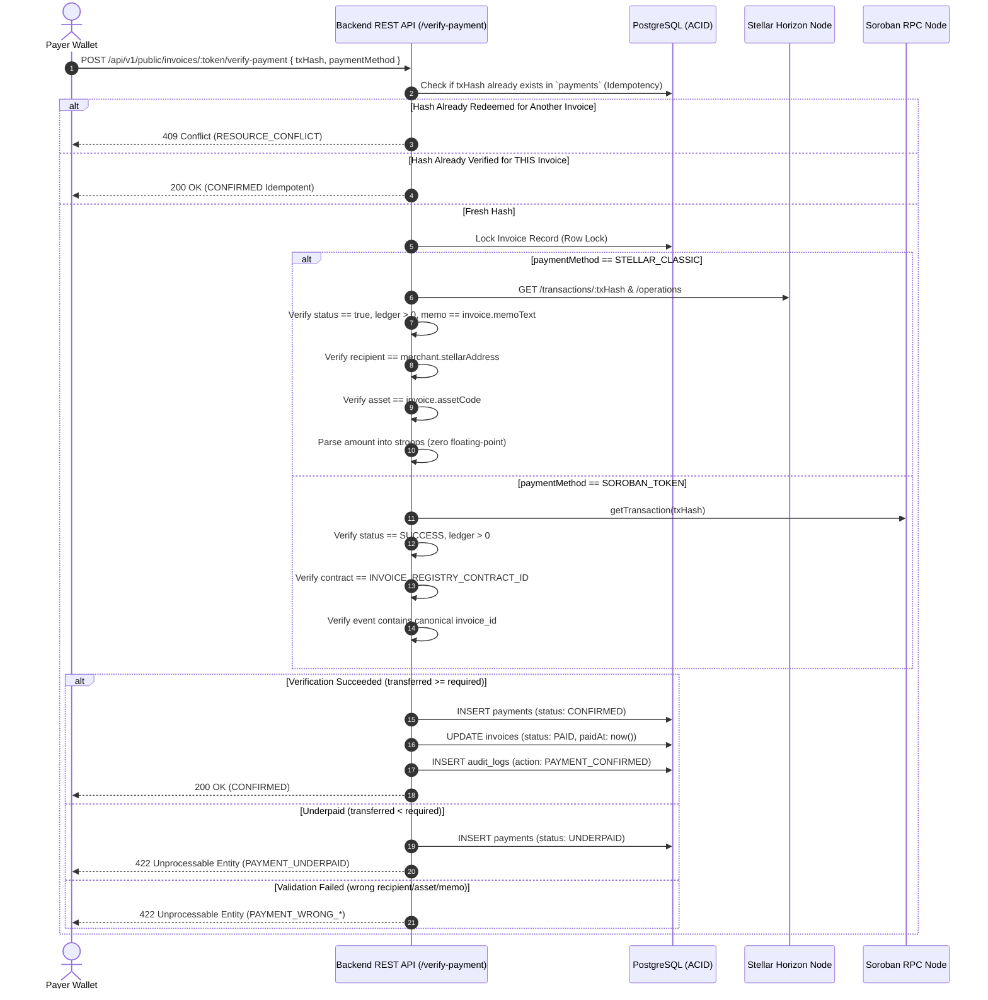

# Stellar & Soroban Payment Verification Engine — Architectural Design & Limitations

**Repository:** `bill-generator-backend`  
**Document Version:** 1.0.0  
**Target Runtimes:** Stellar Horizon API & Soroban Protocol 22 RPC  

---

## 1. Executive Summary & Zero-Trust Architecture

The **Stellar Bill Generator Payment Verification Engine** is an off-chain settlement verification subsystem engineered to provide cryptographic finality for invoice settlements across the Stellar network.

### Zero-Trust Core Invariant
Frontend client applications and payer wallets are treated as untrusted runtime environments. State transitions from `ISSUED` or `OVERDUE` to `PAID` are **never executed based on client assertions or optimistic UI events**. The backend independently queries trusted Stellar Horizon nodes and Soroban RPC servers, verifies ledger finality, inspects operations, and enforces mathematical consistency.

---

## 2. Dual Settlement Verification Pipelines

The verification engine provides two decoupled, protocol-specific verification pipelines:

### 2.1 Pipeline A: Stellar Classic L1 Transfers (Horizon API)
For native XLM and classic issued assets (e.g. USDC trustlines):
1. **Transaction Existence & Status:**
   - Query `GET /transactions/:txHash`.
   - Assert `transaction.successful === true`.
   - Assert `transaction.ledger_attr > 0` (finalized in closed ledger).
2. **Memo Identifier Matching:**
   - Payer transactions must attach a `MEMO_TEXT` matching `invoice.memoText`.
   - Protects against ambiguity when a merchant receives multiple identical payments.
3. **Operation Traversal & Matching:**
   - Query `GET /transactions/:txHash/operations`.
   - Inspect operations of type `payment`, `path_payment_strict_receive`, and `path_payment_strict_send`.
   - Verify `destination === merchant.stellarAddress`.
4. **Asset Identity Verification:**
   - For native XLM: `asset_type === 'native'`.
   - For classic assets: `asset_code === invoice.assetCode` and `asset_issuer === invoice.assetIssuer`.
5. **Zero-Float String Parsing:**
   - Horizon amounts are formatted as decimal strings with up to 7 decimal places (e.g. `"100.5000000"`).
   - String-to-BigInt conversion:
     $$\text{stroops} = \text{BigInt}(\text{whole}) \times 10^7 + \text{BigInt}(\text{fraction padded to 7 digits})$$

### 2.2 Pipeline B: Soroban Smart Contract Tokens (Soroban RPC)
For smart contract tokens (SEP-41) interacting with the on-chain `InvoiceRegistry`:
1. **RPC Invocation Status:**
   - Query `sorobanServer.getTransaction(txHash)`.
   - Assert `txResponse.status === 'SUCCESS'`.
   - Assert `txResponse.ledger > 0`.
2. **Contract & Event Verification:**
   - Inspect `txResponse.resultMetaXdr` to verify the execution targeted the configured `INVOICE_REGISTRY_CONTRACT_ID`.
   - Extract contract events and confirm the `pay` event topic contains the canonical 32-byte `invoice_id`.
3. **Storage Amount Invariant:**
   - In Soroban, the token transfer amount is enforced by the smart contract reading directly from persistent storage (`record.amount`), preventing any client-side tampering with prices.

---

## 3. Idempotency, Race Conditions & Replay Protection

Payment replay attacks and concurrent verification requests are prevented through layered database constraints:

1. **Unique Transaction Hash Constraint:**
   - The PostgreSQL `payments` table enforces `UNIQUE(tx_hash)`.
   - It is physically impossible for the same transaction hash to be inserted twice into the database.
2. **Row-Level Transaction Isolation:**
   - Payment verification runs inside a serializable database transaction with row locks on the `invoices` table.
   - If two concurrent requests submit the same `txHash`, the second request detects the existing payment record and returns an idempotent `200 OK` (if for the same invoice) or a `409 Conflict` (if attempting to reuse the hash on another invoice).
3. **State Machine Immutability:**
   - Once an invoice transitions to `PAID`, its state is strictly terminal and immutable.

---

## 4. Underpayment, Overpayment & Failure Handling

| Scenario | State Machine Action | Database Action | API Response |
| :--- | :--- | :--- | :--- |
| **Full Payment** | `ISSUED` $\to$ `PAID` | Payment inserted as `CONFIRMED`. `paidAt` recorded. | `200 OK` (`CONFIRMED`) |
| **Overpayment** | `ISSUED` $\to$ `PAID` | Payment inserted as `CONFIRMED`. `excessStroops` recorded for refund/accounting. | `200 OK` (`CONFIRMED`) |
| **Underpayment** | Retains current status (`ISSUED` or `OVERDUE`) | Payment attempt inserted as `UNDERPAID` with shortfall audit notes. | `422 Unprocessable Entity` (`PAYMENT_UNDERPAID`) |
| **Wrong Memo** | No status change | No payment record inserted. | `422 Unprocessable Entity` (`PAYMENT_WRONG_MEMO`) |
| **Wrong Destination** | No status change | No payment record inserted. | `422 Unprocessable Entity` (`PAYMENT_WRONG_RECIPIENT`) |
| **Wrong Asset** | No status change | No payment record inserted. | `422 Unprocessable Entity` (`PAYMENT_WRONG_ASSET`) |
| **Missing / Unsettled Tx**| No status change | No payment record inserted. | `422 Unprocessable Entity` (`TRANSACTION_NOT_FOUND`) |
| **Replay Attempt** | No status change | Insertion rejected by constraint. | `409 Conflict` (`RESOURCE_CONFLICT`) |

---

## 5. Documented Limitations & Edge Cases

### 5.1 Horizon Node Pruning & History Retention
- **Limitation:** Public Stellar Horizon nodes may prune transaction and operation histories beyond a certain retention horizon (typically several months to a year).
- **Mitigation:** In production, enterprise deployments should utilize dedicated Horizon archive instances or store permanent cryptographic proof (ledger sequence, close timestamp, transaction hash, and parsed metadata) locally in PostgreSQL.

### 5.2 Multi-Operation Transactions
- **Limitation:** If a payer bundles multiple payments to the merchant within a single transaction, the verification engine locates the first matching operation whose amount satisfies the invoice.
- **Guidance:** Payers are instructed to submit dedicated transactions per invoice.

### 5.3 Network Latency & Soroban RPC Finality
- **Limitation:** Soroban RPC transactions may take 3–5 seconds to finalize into a closed ledger. Submitting `/verify-payment` immediately after client wallet submission may occasionally return `TRANSACTION_PENDING`.
- **Mitigation:** The frontend payment modal implements a brief exponential backoff retry loop (polling `/status` or retrying `/verify-payment` up to 3 times).

### 5.4 Soroban Contract State TTL
- **Limitation:** Soroban persistent storage entries are subject to Protocol 22 State Archival / TTL expiration if not renewed before `LEDGER_THRESHOLD` (~1 day).
- **Mitigation:** The `InvoiceRegistry` contract extends entry TTL to `518,400` ledgers (~30 days) on every read and write operation.
